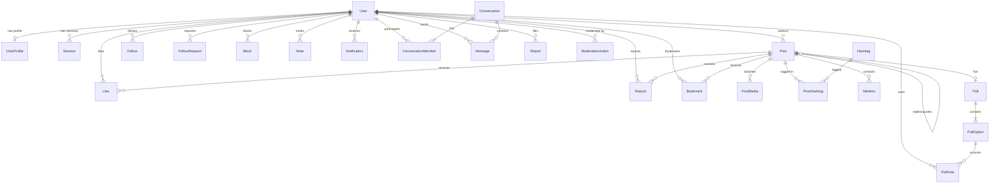

# VARTA Database Schema & Model Specification
**Engine:** PostgreSQL 16 (Relational & Full-Text Search)  
**ORM:** Prisma ORM with versioned migrations  
**Target:** Monorepo package `@varta/database`

---

## 1. Relational Entity Overview

The schema is strictly normalized. No arbitrary JSON blobs are used for relational or constrained data.



---

## 2. Complete Prisma Schema Definition

Below is the definitive schema implemented in `packages/database/prisma/schema.prisma`:

```prisma
datasource db {
  provider = "postgresql"
  url      = env("DATABASE_URL")
}

generator client {
  provider = "prisma-client-js"
}

enum Role {
  USER
  MODERATOR
  ADMIN
}

enum AccountStatus {
  ACTIVE
  PENDING_VERIFICATION
  SUSPENDED
  DEACTIVATED
  DELETED
}

enum FollowRequestStatus {
  PENDING
  ACCEPTED
  REJECTED
}

enum MediaType {
  IMAGE
  VIDEO
  GIF
}

enum NotificationType {
  LIKE
  REPOST
  REPLY
  QUOTE
  MENTION
  FOLLOW
  FOLLOW_REQUEST
  FOLLOW_ACCEPTED
  DIRECT_MESSAGE
  SYSTEM_ALERT
}

enum ReportCategory {
  SPAM
  HARASSMENT
  HATE_SPEECH
  IMPERSONATION
  MISINFORMATION
  VIOLENCE
  ADULT_CONTENT
  COPYRIGHT
  OTHER
}

enum ReportStatus {
  PENDING
  UNDER_REVIEW
  RESOLVED
  DISMISSED
}

enum ModerationActionType {
  WARN
  TAKEDOWN_CONTENT
  TEMPORARY_SUSPENSION
  PERMANENT_BAN
}

model User {
  id               String        @id @default(uuid())
  email            String        @unique
  username         String        @unique
  passwordHash     String
  role             Role          @default(USER)
  status           AccountStatus @default(ACTIVE)
  isPrivate        Boolean       @default(false)
  isVerified       Boolean       @default(false)
  emailVerifiedAt  DateTime?
  createdAt        DateTime      @default(now())
  updatedAt        DateTime      @updatedAt
  deletedAt        DateTime?

  profile               UserProfile?
  sessions              Session[]
  posts                 Post[]
  likes                 Like[]
  reposts               Repost[]
  bookmarks             Bookmark[]
  following             Follow[]              @relation("FollowerRelation")
  followers             Follow[]              @relation("FollowingRelation")
  sentFollowRequests    FollowRequest[]       @relation("SentFollowRequests")
  receivedFollowRequests FollowRequest[]      @relation("ReceivedFollowRequests")
  blockedUsers          Block[]               @relation("BlockerRelation")
  blockedBy             Block[]               @relation("BlockedRelation")
  mutedUsers            Mute[]                @relation("MuterRelation")
  pollVotes             PollVote[]
  mentions              Mention[]
  notificationsReceived Notification[]        @relation("NotificationRecipient")
  notificationsActed    Notification[]        @relation("NotificationActor")
  notificationPref      NotificationPreference?
  conversations         ConversationMember[]
  messagesSent          Message[]
  reportsFiled          Report[]              @relation("ReporterRelation")
  reportsReceived       Report[]              @relation("ReportedUserRelation")
  moderationActions     ModerationAction[]    @relation("ModeratedUserRelation")
  adminActionsTaken     ModerationAction[]    @relation("ModeratorRelation")
  auditLogs             AuditLog[]

  @@index([username])
  @@index([email])
  @@index([status])
}

model UserProfile {
  id          String   @id @default(uuid())
  userId      String   @unique
  user        User     @relation(fields: [userId], references: [id], onDelete: Cascade)
  displayName String
  bio         String?  @db.VarChar(300)
  avatarUrl   String?
  coverUrl    String?
  website     String?  @db.VarChar(200)
  location    String?  @db.VarChar(100)
  createdAt   DateTime @default(now())
  updatedAt   DateTime @updatedAt
}

model Session {
  id           String    @id @default(uuid())
  userId       String
  user         User      @relation(fields: [userId], references: [id], onDelete: Cascade)
  refreshTokenHash String @unique
  userAgent    String?
  ipAddress    String?
  expiresAt    DateTime
  revokedAt    DateTime?
  createdAt    DateTime  @default(now())
  updatedAt    DateTime  @updatedAt

  @@index([userId])
  @@index([refreshTokenHash])
}

model Post {
  id           String    @id @default(uuid())
  authorId     String
  author       User      @relation(fields: [authorId], references: [id], onDelete: Cascade)
  content      String    @db.VarChar(500)
  
  // Threading / Replies
  parentId     String?
  parent       Post?     @relation("PostReplies", fields: [parentId], references: [id], onDelete: SetNull)
  replies      Post[]    @relation("PostReplies")

  // Reposts & Quotes
  repostOfId   String?
  repostOf     Post?     @relation("PostReposts", fields: [repostOfId], references: [id], onDelete: SetNull)
  reposts      Post[]    @relation("PostReposts")

  quotePostId  String?
  quotePost    Post?     @relation("PostQuotes", fields: [quotePostId], references: [id], onDelete: SetNull)
  quotedIn     Post[]    @relation("PostQuotes")

  // Counters (cached for fast reads, authoritatively reconciled)
  likeCount    Int       @default(0)
  replyCount   Int       @default(0)
  repostCount  Int       @default(0)
  quoteCount   Int       @default(0)
  bookmarkCount Int      @default(0)

  // Status & Timestamps
  isEdited     Boolean   @default(false)
  deletedAt    DateTime?
  createdAt    DateTime  @default(now())
  updatedAt    DateTime  @updatedAt

  media        PostMedia[]
  likes        Like[]
  repostItems  Repost[]
  bookmarks    Bookmark[]
  hashtags     PostHashtag[]
  mentions     Mention[]
  poll         Poll?
  reports      Report[]

  @@index([authorId, createdAt(sort: Desc)])
  @@index([createdAt(sort: Desc), id])
  @@index([parentId])
  @@index([repostOfId])
}

model PostMedia {
  id           String    @id @default(uuid())
  postId       String
  post         Post      @relation(fields: [postId], references: [id], onDelete: Cascade)
  type         MediaType
  url          String
  thumbnailUrl String?
  mimeType     String
  sizeBytes    Int
  width        Int?
  height       Int?
  order        Int       @default(0)
  createdAt    DateTime  @default(now())

  @@index([postId])
}

model Poll {
  id        String       @id @default(uuid())
  postId    String       @unique
  post      Post         @relation(fields: [postId], references: [id], onDelete: Cascade)
  question  String       @db.VarChar(200)
  expiresAt DateTime
  createdAt DateTime     @default(now())
  options   PollOption[]
}

model PollOption {
  id        String     @id @default(uuid())
  pollId    String
  poll      Poll       @relation(fields: [pollId], references: [id], onDelete: Cascade)
  text      String     @db.VarChar(100)
  voteCount Int        @default(0)
  order     Int        @default(0)
  votes     PollVote[]

  @@index([pollId])
}

model PollVote {
  id        String     @id @default(uuid())
  pollId    String
  optionId  String
  option    PollOption @relation(fields: [optionId], references: [id], onDelete: Cascade)
  userId    String
  user      User       @relation(fields: [userId], references: [id], onDelete: Cascade)
  createdAt DateTime   @default(now())

  @@unique([pollId, userId]) // Exactly 1 vote per user per poll
  @@index([userId])
}

model Follow {
  id          String   @id @default(uuid())
  followerId  String
  follower    User     @relation("FollowerRelation", fields: [followerId], references: [id], onDelete: Cascade)
  followingId String
  following   User     @relation("FollowingRelation", fields: [followingId], references: [id], onDelete: Cascade)
  createdAt   DateTime @default(now())

  @@unique([followerId, followingId])
  @@index([followerId])
  @@index([followingId])
}

model FollowRequest {
  id          String              @id @default(uuid())
  senderId    String
  sender      User                @relation("SentFollowRequests", fields: [senderId], references: [id], onDelete: Cascade)
  receiverId  String
  receiver    User                @relation("ReceivedFollowRequests", fields: [receiverId], references: [id], onDelete: Cascade)
  status      FollowRequestStatus @default(PENDING)
  createdAt   DateTime            @default(now())
  updatedAt   DateTime            @updatedAt

  @@unique([senderId, receiverId])
  @@index([receiverId, status])
}

model Block {
  id        String   @id @default(uuid())
  blockerId String
  blocker   User     @relation("BlockerRelation", fields: [blockerId], references: [id], onDelete: Cascade)
  blockedId String
  blocked   User     @relation("BlockedRelation", fields: [blockedId], references: [id], onDelete: Cascade)
  createdAt DateTime @default(now())

  @@unique([blockerId, blockedId])
  @@index([blockerId])
  @@index([blockedId])
}

model Mute {
  id        String   @id @default(uuid())
  muterId   String
  muter     User     @relation("MuterRelation", fields: [muterId], references: [id], onDelete: Cascade)
  mutedId   String
  createdAt DateTime @default(now())

  @@unique([muterId, mutedId])
  @@index([muterId])
}

model Like {
  id        String   @id @default(uuid())
  userId    String
  user      User     @relation(fields: [userId], references: [id], onDelete: Cascade)
  postId    String
  post      Post     @relation(fields: [postId], references: [id], onDelete: Cascade)
  createdAt DateTime @default(now())

  @@unique([userId, postId])
  @@index([postId])
  @@index([userId])
}

model Repost {
  id        String   @id @default(uuid())
  userId    String
  user      User     @relation(fields: [userId], references: [id], onDelete: Cascade)
  postId    String
  post      Post     @relation(fields: [postId], references: [id], onDelete: Cascade)
  createdAt DateTime @default(now())

  @@unique([userId, postId])
  @@index([postId])
  @@index([userId])
}

model Bookmark {
  id        String   @id @default(uuid())
  userId    String
  user      User     @relation(fields: [userId], references: [id], onDelete: Cascade)
  postId    String
  post      Post     @relation(fields: [postId], references: [id], onDelete: Cascade)
  createdAt DateTime @default(now())

  @@unique([userId, postId])
  @@index([userId, createdAt(sort: Desc)])
}

model Hashtag {
  id         String        @id @default(uuid())
  tag        String        @unique // stored lowercased without leading '#'
  usageCount Int           @default(0)
  createdAt  DateTime      @default(now())
  updatedAt  DateTime      @updatedAt
  posts      PostHashtag[]

  @@index([tag])
  @@index([usageCount(sort: Desc)])
}

model PostHashtag {
  id        String   @id @default(uuid())
  postId    String
  post      Post     @relation(fields: [postId], references: [id], onDelete: Cascade)
  hashtagId String
  hashtag   Hashtag  @relation(fields: [hashtagId], references: [id], onDelete: Cascade)
  createdAt DateTime @default(now())

  @@unique([postId, hashtagId])
  @@index([hashtagId])
}

model Mention {
  id        String   @id @default(uuid())
  postId    String
  post      Post     @relation(fields: [postId], references: [id], onDelete: Cascade)
  userId    String
  user      User     @relation(fields: [userId], references: [id], onDelete: Cascade)
  createdAt DateTime @default(now())

  @@unique([postId, userId])
  @@index([userId])
}

model Notification {
  id         String           @id @default(uuid())
  userId     String
  user       User             @relation("NotificationRecipient", fields: [userId], references: [id], onDelete: Cascade)
  actorId    String
  actor      User             @relation("NotificationActor", fields: [actorId], references: [id], onDelete: Cascade)
  type       NotificationType
  entityId   String?          // e.g. postId, followId
  message    String?
  isRead     Boolean          @default(false)
  createdAt  DateTime         @default(now())

  @@index([userId, isRead, createdAt(sort: Desc)])
  @@index([userId, createdAt(sort: Desc)])
}

model NotificationPreference {
  id             String  @id @default(uuid())
  userId         String  @unique
  user           User    @relation(fields: [userId], references: [id], onDelete: Cascade)
  emailOnLike    Boolean @default(false)
  emailOnReply   Boolean @default(true)
  emailOnMention Boolean @default(true)
  emailOnFollow  Boolean @default(true)
  emailOnDM      Boolean @default(true)
  pushOnLike     Boolean @default(true)
  pushOnReply    Boolean @default(true)
  pushOnMention  Boolean @default(true)
  pushOnFollow   Boolean @default(true)
  pushOnDM       Boolean @default(true)
}

model Conversation {
  id        String               @id @default(uuid())
  createdAt DateTime             @default(now())
  updatedAt DateTime             @updatedAt
  members   ConversationMember[]
  messages  Message[]

  @@index([updatedAt(sort: Desc)])
}

model ConversationMember {
  id             String       @id @default(uuid())
  conversationId String
  conversation   Conversation @relation(fields: [conversationId], references: [id], onDelete: Cascade)
  userId         String
  user           User         @relation(fields: [userId], references: [id], onDelete: Cascade)
  lastReadAt     DateTime     @default(now())
  createdAt      DateTime     @default(now())

  @@unique([conversationId, userId])
  @@index([userId])
}

model Message {
  id             String       @id @default(uuid())
  conversationId String
  conversation   Conversation @relation(fields: [conversationId], references: [id], onDelete: Cascade)
  senderId       String
  sender         User         @relation(fields: [senderId], references: [id], onDelete: Cascade)
  content        String       @db.VarChar(2000)
  mediaUrl       String?
  isRead         Boolean      @default(false)
  createdAt      DateTime     @default(now())

  @@index([conversationId, createdAt(sort: Desc)])
}

model Report {
  id           String         @id @default(uuid())
  reporterId   String
  reporter     User           @relation("ReporterRelation", fields: [reporterId], references: [id], onDelete: Cascade)
  reportedId   String?
  reportedUser User?          @relation("ReportedUserRelation", fields: [reportedId], references: [id], onDelete: SetNull)
  postId       String?
  post         Post?          @relation(fields: [postId], references: [id], onDelete: SetNull)
  category     ReportCategory
  reason       String         @db.VarChar(1000)
  status       ReportStatus   @default(PENDING)
  createdAt    DateTime       @default(now())
  updatedAt    DateTime       @updatedAt

  @@index([status, createdAt(sort: Desc)])
  @@index([reportedId])
  @@index([postId])
}

model ModerationAction {
  id          String               @id @default(uuid())
  moderatorId String
  moderator   User                 @relation("ModeratorRelation", fields: [moderatorId], references: [id])
  targetUserId String
  targetUser  User                 @relation("ModeratoredUserRelation", fields: [targetUserId], references: [id], onDelete: Cascade)
  actionType  ModerationActionType
  reason      String               @db.VarChar(500)
  expiresAt   DateTime?
  createdAt   DateTime             @default(now())

  @@index([targetUserId])
  @@index([moderatorId])
}

model AuditLog {
  id        String   @id @default(uuid())
  actorId   String
  actor     User     @relation(fields: [actorId], references: [id])
  action    String
  entity    String
  entityId  String
  details   String?  @db.Text
  ipAddress String?
  createdAt DateTime @default(now())

  @@index([actorId])
  @@index([entity, entityId])
  @@index([createdAt(sort: Desc)])
}
```
